<h1 align="center">Hi 👻, I'm Miguel!</h1>

  
  
  
  
  

---

<h3 align="left">✨ Software Engineering Student | UNMSM</h3>

  🌴 Fullstacker, Database Manager & Junior IT Specialist. 
  💻 Currently working as Software Developer in Sunass. 
  📽️ Also have a YT Channel: <b>@Mega_Trailers</b>

---

<!-- Pacman Contribution Animation -->

  

---

<h3 align="left">🖥️ Languages & Skills</h3>

  

---

<h3 align="left">📊 My Stats</h3>

  
  

---
